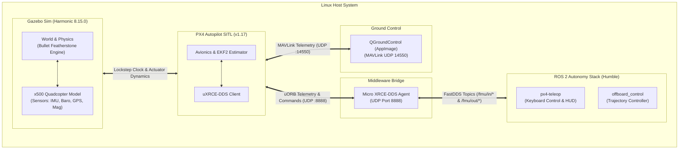

# Drone Club Autonomous Simulation & Flight Stack 🛸

[[Welcome|← Vault Index]] | [[Robotics Simulation Pipeline|Simulation Pipeline MOC]] | [[Quick Reference & Launch Script|Launch Script Cheat Sheet →]]

A high-performance, modular robotics simulation pipeline integrating **PX4 Autopilot (v1.17)**, **Gazebo Harmonic (8.15.0)**, **Micro XRCE-DDS**, and **ROS 2 Humble** on Linux.

---

## ⚡ Quick Start

### 1. Launch the Complete Simulation Stack
From the `installed gigs/` directory:
```bash
cd "installed gigs"
./start_sim.sh
```
This automatically launches a structured multi-pane `tmux` environment:
- **Pane 0 (Left)**: Micro XRCE-DDS Agent bridging PX4 to ROS 2.
- **Pane 1 (Top Right)**: PX4 SITL + Gazebo Harmonic physics simulation.
- **Pane 2 (Bottom Right)**: Interactive ROS 2 shell with workspace environment ready.
- **Background**: QGroundControl flight dashboard.

### 2. Fly the Drone via Keyboard Teleop
Inside Pane 2 (or any terminal):
```bash
px4-teleop
```
- Press **`T`** to arm, engage offboard control, and climb to 2.5m altitude.
- Use **`W/A/S/D`** to fly forward, left, backward, and right.
- Use **`Up/Down`** arrow keys to ascend and descend.
- Use **`Left/Right`** arrow keys to rotate heading (yaw).
- Press **`Space`** to brake/hover in place.
- Press **`L`** to land smoothly.

---

## 🏗️ Architecture & Dataflow




---

## 📁 Repository Structure

```plaintext
DC- Drone Club/
├── Parts_library/                      # Independent Gazebo Harmonic modular model entities
│   ├── chassis/                        # Central airframe, carbon decks, landing skids, battery & avionics
│   ├── t_motor_f60/                    # Actuator unit: stator base, midnight-blue bell, prop & motor plugin
│   ├── livox_mid360/                   # Perception unit: heatsink housing, sapphire dome & 360°x59° GPU LiDAR
│   ├── modular_drone/                  # Master assembly integrating all sub-models via SDF includes & joints
│   └── README.md                       # Comprehensive parts library setup & component swapping guide
├── installed gigs/                      # Primary simulation binaries, launchers & shortcuts
│   ├── start_sim.sh                    # Unified multi-pane simulation orchestrator (-m modular_drone)
│   ├── px4-teleop                      # Interactive keyboard teleoperation launcher
│   ├── ros2-shell                      # Containerized ROS 2 development subshell
│   ├── MicroXRCEAgent                  # Symlink to DDS bridge binary
│   ├── PX4-Autopilot                   # Symlink to PX4 repository
│   ├── px4_ros2_ws                     # Symlink to ROS 2 autonomy workspace
│   ├── Model/                          # Symlinks to modular model entities
│   ├── QGroundControl.AppImage         # Symlink to GCS AppImage
│   ├── README.md                       # Detailed tooling documentation
│   └── PX4_MIGRATION_LEDGER.md         # Comprehensive ArduPilot -> PX4 migration records
├── Drone Club DC Vault/                 # Obsidian knowledge base & engineering documentation
│   ├── Robotics Simulation Pipeline.md # Master pipeline MOC note
│   ├── Welcome.md                      # Vault index and fast links
│   └── Simulation/                     # Step-by-step guides, telemetry references & runbooks
│       ├── 01 - PX4 Autopilot SITL Setup.md
│       ├── 02 - Gazebo Harmonic Setup.md
│       ├── 03 - Micro XRCE-DDS & ROS 2 Setup.md
│       ├── 04 - Shell Environment & Launch Automation.md
│       ├── 05 - QGroundControl Setup.md
│       ├── 06 - Smoke Test & Flight Verification.md
│       ├── 07 - Sample Drone Flight.md
│       ├── 08 - Performance & Troubleshooting Guide.md
│       ├── 09 - Modular Drone & Parts Library Setup.md
│       ├── PX4 ROS2 Migration Ledger.md
│       ├── Quick Reference & Launch Script.md
│       └── Old Stack - ArduPilot/      # Archived ArduPilot documentation (Steps 1-6)
├── legacy_ardupilot/                   # Archived legacy scripts (sample_drone_flight.py) & README
└── README.md                           # Master repository overview
```

---

## 🎮 Key Controls Reference (`px4-teleop`)

| Command / Action | Key(s) | Description |
| :--- | :--- | :--- |
| **Auto-Takeoff** | `T` | Arms drone, engages offboard mode, climbs to 2.5m, and locks into stable hover |
| **Hover / Brake** | `Space` / `H` | Zeroes velocity commands and actively locks target yaw |
| **Land** | `L` | Initiates autonomous landing descent; disarms on ground contact |
| **Flight Mode Toggle** | `M` | Toggles between **`BODY-RELATIVE`** (nose-aligned) and `WORLD-RELATIVE` (compass North) |
| **Pitch (Forward / Back)** | `W` / `S` | Drives forward along the drone's nose direction / reverses backward |
| **Roll (Strafe Left / Right)** | `A` / `D` | Strafes sideways left / right relative to vehicle orientation |
| **Altitude (Climb / Descend)**| `Up` / `R` / `I` & `Down` / `F` / `K` | Vertical ascent ($-Z$ NED) / Descent ($+Z$ NED) |
| **Yaw (Turn Left / Right)** | `Left` / `Q` & `Right` / `E` | Rotates heading counter-clockwise / clockwise (actively holds angle when released) |
| **Arm / Disarm** | `O` (Arm) / `P` (Disarm) | Manual motor arming and emergency kill switch |
| **Speed Modes** | `1` / `2` / `3` | Speed scale: Slow (0.5 m/s), Normal (1.5 m/s), Fast (3.0 m/s) |

---

## 🛠️ CLI Utilities & Options

```bash
# Check status of running simulation processes and network ports:
./"installed gigs"/start_sim.sh --status

# Run in headless mode (server physics without 3D GUI for minimal CPU load):
./"installed gigs"/start_sim.sh --headless

# Terminate all simulation sessions, background agents, and QGC:
./"installed gigs"/start_sim.sh --kill
```

For in-depth guides, open the Obsidian notes inside this vault (starting at [[Welcome]]) or refer to [[Installed Gigs & Simulation Tooling]] ([`../installed gigs/`](../installed%20gigs/)).
