# Robotics Simulation Pipeline: PX4 SITL + Gazebo Harmonic + Micro XRCE-DDS + ROS 2

> [!abstract] Overview
> This guide details the unified, production-grade robotics simulation pipeline for autonomous drone development on Linux. It links **PX4 Autopilot (v1.17)** for native avionics and state estimation, **Gazebo Sim (Harmonic 8.15.0)** for multi-body physics and sensor simulation, the **Micro XRCE-DDS Agent** for low-latency uORB-to-ROS 2 bridging, and **ROS 2 Humble** for offboard navigation and interactive keyboard flight (`px4-teleop`).

---

## 🗺️ System Architecture & Dataflow Map

The following diagram illustrates how physics, clock synchronization, avionics, DDS middleware, and telemetry streams communicate in this pipeline:

```mermaid
flowchart TD
    subgraph Host ["Linux Host System"]
        subgraph GazeboEngine ["Gazebo Sim (Harmonic / gz-sim8)"]
            World["World & Models<br/>(default.sdf / x500)"]
            Physics["Physics Engine<br/>(Bullet Featherstone)"]
            Sensors["Sensor Simulation<br/>(IMU, Baro, GPS, Magnetometer)"]
            
            World --> Physics
            Physics --> Sensors
        end

        subgraph Autopilot ["PX4 Autopilot SITL (v1.17)"]
            SITL_Core["px4 binary (ROMFS / px4fmu_common)"]
            EKF["EKF2 State Estimator"]
            UXRCE_Client["uxrce_dds_client Module"]
            
            SITL_Core <--> EKF
            SITL_Core <--> UXRCE_Client
        end

        subgraph Middleware ["XRCE-DDS Middleware Bridge"]
            XRCE_Agent["MicroXRCEAgent<br/>(UDP Port 8888)"]
        end

        subgraph ROS2Stack ["ROS 2 Autonomy Stack (Humble)"]
            Teleop["px4-teleop<br/>(Interactive Keyboard Node)"]
            Offboard["offboard_control<br/>(Autonomous Trajectory Node)"]
            ROS2_Shell["ros2-shell<br/>(CLI & Diagnostics Environment)"]
        end

        subgraph GroundStation ["Ground Control & Monitoring"]
            QGC["QGroundControl (GCS)<br/>(AppImage)"]
        end
    end

    %% Communication Bridges
    GazeboEngine <==>|"Lockstep Clock, Motor Dynamics & Sensors"| SITL_Core
    UXRCE_Client <==>|"uORB Serialized Packets (UDP Port 8888)"| XRCE_Agent
    XRCE_Agent <==>|"FastDDS Topics (/fmu/in/* & /fmu/out/*)"| ROS2Stack
    SITL_Core <==>|"MAVLink Telemetry (UDP Port 14550)"| QGC

    %% Styling
    classDef gz fill:#23272e,stroke:#61afef,stroke-width:2px,color:#abb2bf;
    classDef px4 fill:#1e272c,stroke:#98c379,stroke-width:2px,color:#abb2bf;
    classDef dds fill:#2d2238,stroke:#c678dd,stroke-width:2px,color:#abb2bf;
    classDef ros fill:#282c34,stroke:#e5c07b,stroke-width:2px,color:#abb2bf;
    classDef gcs fill:#1f3333,stroke:#56b6c2,stroke-width:2px,color:#abb2bf;
    class GazeboEngine gz;
    class Autopilot px4;
    class Middleware dds;
    class ROS2Stack ros;
    class GroundStation gcs;
```

---

## 🧩 Component Responsibility Matrix

| Component                  | Role                                                                                                          | Protocol / Interface      | Note Reference                               |                                       |
| :------------------------- | :------------------------------------------------------------------------------------------------------------ | :------------------------ | :------------------------------------------- | ------------------------------------- |
| **Day One Quickstart**     | Zero-to-hero onboarding, architecture mental model, Ubuntu/Arch copy-paste commands, automated doctor script. | Bash / Diagnostics        | [[00 - Day One Zero-to-Hero Quickstart       | Step 0: Day One Quickstart]]          |
| **PX4 Autopilot SITL**     | Runs full flight firmware, EKF2 state estimator, failsafe logic, and offboard mode managers.                  | Native C++ binary & uORB  | [[01 - PX4 Autopilot SITL Setup              | Step 1: PX4 SITL Setup]]              |
| **Gazebo Sim (Harmonic)**  | Simulates rigid-body dynamics (Bullet Featherstone engine), aerodynamics, collisions, and sensor models.      | Gazebo Transport & SDF    | [[02 - Gazebo Harmonic Setup                 | Step 2: Gazebo Sim & Physics Tuning]] |
| **Micro XRCE-DDS Agent**   | Fast DDS bridge translating PX4 internal uORB topics directly to ROS 2 standard message structures.           | UDP Port `8888`           | [[03 - Micro XRCE-DDS & ROS 2 Setup          | Step 3: Micro XRCE-DDS Middleware]]   |
| **Shell & Launch Config**  | Configures physics engine path, spawn poses, camera follow, and ROS 2 environment paths.                      | Bash / Zsh Profile        | [[04 - Shell Environment & Launch Automation | Step 4: Environment & Paths]]         |
| **QGroundControl**         | User-facing graphical GCS for mission planning, virtual RC sticks, and telemetry verification.                | MAVLink (UDP `14550`)     | [[05 - QGroundControl Setup                  | Step 5: QGroundControl Setup]]        |
| **Verification Sequence**  | 4-Gate automated and manual verification protocol across all simulation layers.                               | Multi-tier validation     | [[06 - Smoke Test & Flight Verification      | Step 6: 4-Gate Smoke Test]]           |
| **ROS 2 `px4-teleop`**     | Native Python ROS 2 node providing interactive keyboard control and live ASCII HUD.                           | FastDDS (`/fmu/*`)        | [[07 - Sample Drone Flight                   | Step 7: Flight & Teleop]]             |
| **Performance & Tuning**   | Diagnostic matrix, attitude recovery, heading stabilization, and headless tuning.                             | Runbooks & RCA            | [[08 - Performance & Troubleshooting Guide   | Step 8: Troubleshooting]]             |
| **Modular Parts Library**  | Modular SDF architecture (chassis, t_motor_f60, livox_mid360, modular_drone).                                 | Gazebo Harmonic & SDF 1.8 | [[09 - Modular Drone & Parts Library Setup   | Step 9: Modular Parts Library]]       |
| **C++ Plugin & Assembly**  | Custom Gazebo system lifecycle plugin, dynamic SDF `<include>` links, and CAD conversion.                    | C++17 & Gazebo Sim System | [[Gazebo_Modular_Drone_Architecture          | Gazebo Modular Architecture]]         |
| **`start_sim.sh`**         | Orchestrates tmux panes, environment variables, background processes, and clean teardown.                     | Bash / tmux               | [[Quick Reference & Launch Script            | Launch Script Cheat Sheet]]           |
| **Installed Gigs & Tools** | Shortcuts, symlinks, and runtimes for installed simulation tooling.                                           | Binaries & Wrappers       | [[Installed Gigs & Simulation Tooling        | Tooling Reference]]                   |
| **Migration Ledger**       | Complete record of legacy ArduPilot decommissioning and PX4 installation.                                     | Architectural Ledger      | [[PX4 ROS2 Migration Ledger                  | Migration Ledger]]                    |

---

## 📡 Essential ROS 2 Interfaces (PX4 v1.17 uXRCE-DDS)

### Control Influx (`/fmu/in/*`)
- `/fmu/in/offboard_control_mode`: Informs PX4 which setpoint fields (position, velocity, acceleration, attitude) are active.
- `/fmu/in/trajectory_setpoint`: Direct kinematic setpoints (NED frame positions, velocities, yaw angle, or yaw rate).
- `/fmu/in/vehicle_command`: Flight executive triggers (Arm/Disarm, Set Mode: Offboard, Takeoff, Land).

### Telemetry Outflux (`/fmu/out/*`)
- `/fmu/out/vehicle_local_position_v1`: High-rate local coordinates $(x, y, z)$, velocities $(v_x, v_y, v_z)$, and heading.
- `/fmu/out/vehicle_status_v1`: Arming state, active navigation mode, and safety lock flags.
- `/fmu/out/vehicle_global_position`: Fused GPS latitude, longitude, and ellipsoidal altitude.
- `/fmu/out/vehicle_odometry`: Body-frame linear velocities and angular rates.

---

## ⏱️ Execution & Verification Pipeline

0. **[[00 - Day One Zero-to-Hero Quickstart]]**: Run `./setup_modular_drone.sh --all` for turnkey installation, `--fix` for auto-provisioning `~/.local/bin/px4-teleop` and model links, `--preview` for 3D model inspection, or `--launch` for direct flight.
1. **[[Quick Reference & Launch Script]]**: Launch the entire multi-pane stack with `./start_sim.sh` or `./start_sim.sh --headless`.
2. **[[06 - Smoke Test & Flight Verification]]**: Verify Gazebo physics, DDS agent connectivity, commander arming checks, and offboard control mode.
3. **[[07 - Sample Drone Flight]]**: Take off, steer body velocities, hover, and land using `px4-teleop` or automated trajectory scripts.
4. **[[08 - Performance & Troubleshooting Guide]]**: Diagnose tilt failures, bounding box collisions, headless performance, and DDS QoS issues.
5. **[[09 - Modular Drone & Parts Library Setup]]**: Build custom airframes, swap actuators, adjust LiDAR pitch angles, and inspect SDF 1.8 hierarchies.

---

## 🔗 Related Notes
- [[Welcome|Vault Index]]
- [[PX4 ROS2 Migration Ledger|ArduPilot to PX4 Migration Ledger]]
- [[09 - Modular Drone & Parts Library Setup|Modular Drone & Parts Library Guide]]
- [[Installed Gigs & Simulation Tooling|Installed Tools & Binaries Reference]] ([`../installed gigs/`](../installed%20gigs/))
- [[Old Stack - ArduPilot/README|Old Stack: ArduPilot SITL Archives]]
- [[Quick Reference & Launch Script]]
