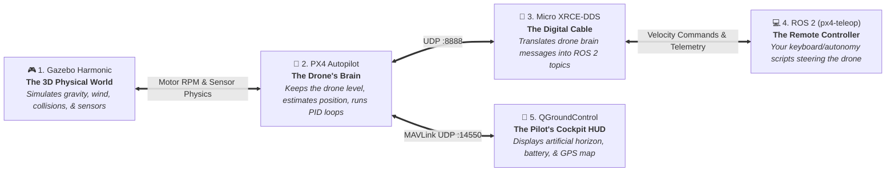

# Step 0: Day One Zero-to-Hero Quickstart & Installation 🚀

[[Welcome|← Vault Index]] | [[Robotics Simulation Pipeline|Simulation Pipeline MOC]] | [[01 - PX4 Autopilot SITL Setup|Next: Step 1 - PX4 SITL Setup →]]

---

## 🎯 Welcome to Drone Club! (Read This First)

If you just joined the team, sat down at a Linux workstation, or cloned this repository for the very first time and have **no idea what PX4, DDS, Gazebo, or SITL mean**—**do not worry**. This document was written specifically for you.

By the end of this page, you will understand how the system works and have a simulated drone flying on your screen with keyboard control.

---

## 🧠 The 5-Minute Mental Model: What Are We Running?

Think of our simulation stack like an actual physical drone, but running entirely inside your computer:



1. **Gazebo Sim (Harmonic 8)**: The video game physics world. It simulates the physical drone airframe, carbon fiber chassis, spinning propellers, gravity, ground contact, and laser LiDAR rays.
2. **PX4 Autopilot SITL**: The drone's flight computer (Software-In-The-Loop). It runs the exact same C++ flight firmware that flies real physical drones. It prevents the drone from flipping and holds altitude.
3. **Micro XRCE-DDS Agent**: The translation bridge. PX4 speaks an internal protocol called *uORB*. This agent translates uORB into standard *ROS 2 topics* (`/fmu/in/*` and `/fmu/out/*`) over UDP port `8888`.
4. **ROS 2 (`px4-teleop`)**: Your keyboard steering station. You press `T` to takeoff, `W/A/S/D` to fly, and `L` to land.
5. **QGroundControl (QGC)**: The ground control station software. It connects via MAVLink (port `14550`) and shows an artificial horizon, altitude tape, and virtual instruments.
6. **Parts Library (`Parts_library/`)**: Our modular LEGO box. You can swap motors, change airframes, or adjust LiDAR angles without touching any code.

---

## ⚡ The 60-Second Express Check

If you are on a lab machine where tools might already be installed, run the automated doctor script right now from the project root:

```bash
cd ../..
./setup_modular_drone.sh
```

- **If all 45 checks pass (green `✔ [OK]`):** You are completely ready to fly! Skip straight to [Your First Flight in 3 Steps](#-your-first-flight-in-3-steps).
- **If checks show missing packages (yellow `⚠ [WARN]` or red `✖ [FAIL]`):** Follow the fresh installation guide below.

---

## 🛠️ Fresh Machine Installation: Step-by-Step

Follow the tab matching your operating system:

### 🐧 For Ubuntu 22.04 LTS (Jammy) or 24.04 LTS (Noble)

#### Step 1: Install Build Tools & Gazebo Harmonic
Open a terminal and paste:
```bash
# 1. Update and install core build tools & tmux
sudo apt update && sudo apt install -y curl lsb-release gnupg git cmake ninja-build build-essential tmux python3-pip

# 2. Add the official Open Robotics Gazebo repository
sudo curl https://packages.osrfoundation.org/gazebo.gpg --output /usr/share/keyrings/pkgs-osrf-archive-keyring.gpg
echo "deb [arch=$(dpkg --print-architecture) signed-by=/usr/share/keyrings/pkgs-osrf-archive-keyring.gpg] http://packages.osrfoundation.org/gazebo/ubuntu-stable $(lsb_release -cs) main" | sudo tee /etc/apt/sources.list.d/gazebo-stable.list > /dev/null

# 3. Install Gazebo Harmonic
sudo apt update && sudo apt install -y gz-harmonic libgz-sim8-dev
```

#### Step 1b: Install ROS 2 (Ubuntu 24.04 Noble or 22.04 Jammy)
```bash
# Set UTF-8 locale & requirements
sudo apt update && sudo apt install -y locales software-properties-common curl
sudo locale-gen en_US en_US.UTF-8
sudo update-locale LC_ALL=en_US.UTF-8 LANG=en_US.UTF-8
export LANG=en_US.UTF-8

# Add ROS 2 key and official repository
sudo add-apt-repository universe -y
sudo curl -sSL https://raw.githubusercontent.com/ros/rosdistro/master/ros.key -o /usr/share/keyrings/ros-archive-keyring.gpg
echo "deb [arch=$(dpkg --print-architecture) signed-by=/usr/share/keyrings/ros-archive-keyring.gpg] http://packages.ros.org/ros2/ubuntu $(lsb_release -cs) main" | sudo tee /etc/apt/sources.list.d/ros2.list > /dev/null

# Install ROS 2 (Jazzy on Ubuntu 24.04 noble, Humble on Ubuntu 22.04 jammy)
sudo apt update
if [ "$(lsb_release -cs)" = "noble" ]; then
    sudo apt install -y ros-jazzy-desktop python3-colcon-common-extensions python3-rosdep python3-vcstool
    echo "source /opt/ros/jazzy/setup.bash" >> ~/.bashrc
else
    sudo apt install -y ros-humble-desktop python3-colcon-common-extensions python3-rosdep python3-vcstool
    echo "source /opt/ros/humble/setup.bash" >> ~/.bashrc
fi
sudo rosdep init 2>/dev/null || true
rosdep update
```

#### Step 2: Clone PX4 Autopilot
```bash
git clone https://github.com/PX4/PX4-Autopilot.git ~/PX4-Autopilot --recursive
cd ~/PX4-Autopilot
# Build once to fetch simulation dependencies and compile SITL
make px4_sitl gz_x500
# Press Ctrl + C once Gazebo opens to exit
```

#### Step 3: Install Micro XRCE-DDS Agent
```bash
git clone https://github.com/eProsima/Micro-XRCE-DDS-Agent.git /tmp/Micro-XRCE-DDS-Agent
cd /tmp/Micro-XRCE-DDS-Agent && mkdir build && cd build
cmake .. -DCMAKE_INSTALL_PREFIX=$HOME/.local
make -j$(nproc)
make install
```

#### Step 4: Download QGroundControl
```bash
curl -L -o ~/QGroundControl.AppImage https://d176tv9ibo4jno.cloudfront.net/latest/QGroundControl.AppImage
chmod +x ~/QGroundControl.AppImage
```

---

### 🏹 For Arch Linux / Manjaro / EndeavourOS

#### Step 1: Install Tools, Compilers & Gazebo Harmonic
```bash
# 1. Install base development libraries via pacman
sudo pacman -S --needed base-devel git cmake ninja ccache tmux python python-pip

# 2. Install Gazebo Harmonic via yay (AUR)
yay -S --needed gz-harmonic
```

#### Step 2: Clone & Build PX4 Autopilot
```bash
git clone https://github.com/PX4/PX4-Autopilot.git ~/PX4-Autopilot --recursive
cd ~/PX4-Autopilot
make px4_sitl gz_x500
# Press Ctrl + C once Gazebo boots to exit
```

#### Step 3: Build Micro XRCE-DDS Agent
```bash
git clone https://github.com/eProsima/Micro-XRCE-DDS-Agent.git /tmp/Micro-XRCE-DDS-Agent
cd /tmp/Micro-XRCE-DDS-Agent && mkdir build && cd build
cmake .. -DCMAKE_INSTALL_PREFIX=$HOME/.local
make -j$(nproc)
make install
```

#### Step 4: Download QGroundControl
```bash
curl -L -o ~/QGroundControl.AppImage https://d176tv9ibo4jno.cloudfront.net/latest/QGroundControl.AppImage
chmod +x ~/QGroundControl.AppImage
```

---

## 🔗 Auto-Configure the Workspace (or 1-Click Install)

You can choose between running the diagnostic doctor, auto-configuring links, previewing models in 3D, or running the entire turnkey installer:

### Option A: Complete Turnkey Setup (`--all`)
If you want the script to automatically install missing OS packages (APT on Ubuntu, Pacman/AUR on Arch), download QGroundControl, clone PX4, provision `~/.local/bin` wrappers, link models, and configure your shell:
```bash
./setup_modular_drone.sh --all
```

### Option B: Configure Symlinks, Wrappers & Shell (`--fix`)
If you installed packages manually and just want the doctor to wire up paths, symlinks, airframes, shell profiles, and auto-generate `~/.local/bin/ros2` and `~/.local/bin/px4-teleop`:
```bash
./setup_modular_drone.sh --fix
```

### Option C: Standalone 3D Gazebo Model Inspection (`--preview`)
Want to visually inspect the carbon-fiber frame, T-Motor actuators, and Livox Mid-360 LiDAR in the Gazebo GUI without running PX4 SITL or ROS 2?
```bash
./setup_modular_drone.sh --preview
```

### Option D: Direct Simulation Launch (`--launch`)
To run system checks and directly launch the full multi-pane simulation flight stack:
```bash
./setup_modular_drone.sh --launch
```

---

### 🎛️ Complete `setup_modular_drone.sh` CLI Flags Reference

| Flag / Option | Description & Use Case |
| :--- | :--- |
| **`-h, --help`** | Displays the command-line usage manual, available flags, and example workflows. |
| **`-p, --preview`** | Spawns `modular_drone` inside standalone Gazebo Sim 3D GUI (`preview_world.sdf`) with Bullet Featherstone physics. |
| **`-l, --launch`** | Initiates the complete multi-pane flight stack via `start_sim.sh -m modular_drone` after verifying system readiness. |
| **`-f, --fix`** | Auto-provisions missing `~/.local/bin/ros2`, `~/.local/bin/px4-teleop`, `~/.local/bin/ros2-shell`, repairs symlinks, and sets up shell profiles. |
| **`-a, --all`** | End-to-end turnkey installer: combines `--install-deps` and `--fix` for single-command setup on a blank Linux machine. |
| **`-i, --install-deps`** | Uses the host package manager (`apt` on Ubuntu, `pacman`/`yay` on Arch) to fetch build tools, Gazebo Harmonic, and QGC. |
| **`--validate-only`** | Headless automated check: runs all 56 gates silently and exits with status `0` (pass) or `1` (fail) for CI pipelines. |

> [!tip] Automatic `~/.local/bin` Wrappers on New Linux Systems (Ubuntu / Arch)
> On a clean Linux installation (such as Ubuntu 24.04 or 22.04), ROS 2 is installed under `/opt/ros/jazzy` or `/opt/ros/humble`. Running `./setup_modular_drone.sh --fix` automatically generates self-sourcing wrappers for `ros2`, `px4-teleop`, and `ros2-shell` in `$HOME/.local/bin`, and adds `$HOME/.local/bin` to your `$PATH`. You can run `px4-teleop` and `ros2` immediately from any terminal!

---

*What the setup tool verifies automatically (56 Gates):*
1. **Detects OS**: Identifies Arch or Ubuntu/Debian and targets the right package manager and library paths.
2. **Installs System Tools** (if `--install-deps` or `--all` is passed): Fetches Gazebo Harmonic, build tools, ccache, python3, tmux, QGC AppImage.
3. **Provisions Local Binaries**: Auto-creates `~/.local/bin/ros2`, `~/.local/bin/px4-teleop`, and `~/.local/bin/ros2-shell`.
4. **Links Modular Models**: Relative symlinks in `installed gigs/Model/` and PX4's `gz/models/`.
5. **Repairs Tooling Links**: Links `installed gigs/px4-teleop`, `ros2`, `MicroXRCEAgent`, `QGroundControl.AppImage`.
6. **Provisions Airframe**: Registers `4025_gz_modular_drone` into PX4 SITL ROMFS and CMake.
7. **Appends Shell Exports**: Exports `PATH`, `PARTS_LIB`, `GZ_SIM_RESOURCE_PATH`, `SDF_PATH`, and `PX4_GZ_PHYSICS_ENGINE` to `~/.bashrc` and `~/.zshrc`.
8. **Audits SDFormat Kinematics**: Validates rigid-body and joint kinematics with `gz sdf -k`.

---

## 🎮 Your First Flight in 3 Steps!

Once `./setup_modular_drone.sh` reports `All checks passed`, launch the complete simulation with a single command:

### 1. Launch the Stack
```bash
cd ../..     # from this note, go to project root
./"installed gigs"/start_sim.sh
```

A 3-pane `tmux` window will pop up:
- **Left Pane:** Micro XRCE-DDS agent listening on UDP port 8888.
- **Top Right Pane:** PX4 SITL booting Gazebo Harmonic in North-aligned chase-camera mode.
- **Bottom Right Pane:** Interactive ROS 2 autonomy shell ready for keyboard commands.
- **Floating Window:** QGroundControl showing live telemetry.

### 2. Take Control with Keyboard (`px4-teleop`)
Click your mouse inside the **bottom-right pane** (or open any new terminal) and run:
```bash
px4-teleop
```

### 3. Flight Controls Cheat Sheet:

| What you want to do | Key to press | What happens |
| :--- | :---: | :--- |
| **Take Off** | **`T`** | Drone motors arm, climb to 2.5 meters altitude, and lock into rock-solid hover. |
| **Fly Forward / Backward** | **`W`** / **`S`** | Flies forward along the drone's nose direction / flies in reverse. |
| **Strafe Left / Right** | **`A`** / **`D`** | Slides sideways without rotating heading. |
| **Climb / Descend** | **`Up`** / **`Down`** | Smooth vertical altitude change. |
| **Turn Left / Right** | **`Left`** / **`Right`** | Smooth yaw rotation; holds heading when released. |
| **Hover / Brake** | **`Space`** | Stops all movement and locks current GPS coordinate and heading. |
| **Land** | **`L`** | Descends gracefully to the ground and automatically disarms motors upon touchdown. |
| **Emergency Disarm** | **`P`** | Immediately kills all motors. |

---

## 🛸 Flying the Modular Drone with LiDAR (`modular_drone`)

To launch our custom modular drone (with T-Motor F60 propulsion, carbon airframe, and Livox Mid-360 solid-state LiDAR payload) instead of the standard stock drone:

```bash
./"installed gigs"/start_sim.sh -m modular_drone
```

To run without 3D graphics (saving 80% CPU/GPU on laptops or servers):
```bash
./"installed gigs"/start_sim.sh -m modular_drone --headless
```

---

## 🛑 How to Stop the Simulation

When you are done flying, close all background processes cleanly:

```bash
./"installed gigs"/start_sim.sh --kill
```

---

## 📚 Where to Go Next?

Now that you have taken your first flight, follow the step-by-step pipeline guides:
1. [[01 - PX4 Autopilot SITL Setup|Step 1: PX4 Autopilot SITL Deep Dive]]
2. [[02 - Gazebo Harmonic Setup|Step 2: Physics Engine Tuning & Bullet Featherstone]]
3. [[03 - Micro XRCE-DDS & ROS 2 Setup|Step 3: Custom ROS 2 Offboard Nodes]]
4. [[09 - Modular Drone & Parts Library Setup|Step 9: Swapping Motors & Modifying the Parts Library]]
5. [[08 - Performance & Troubleshooting Guide|Step 8: Performance Tuning & Troubleshooting Runbooks]]
