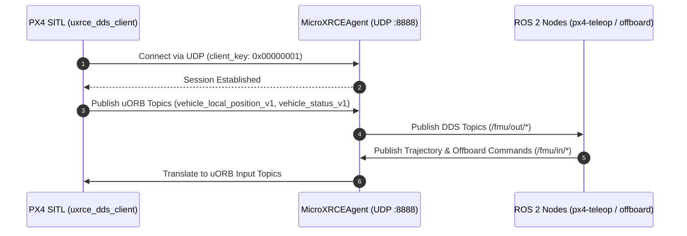

# Step 3: Micro XRCE-DDS Middleware & ROS 2 Autonomy Setup

[[02 - Gazebo Harmonic Setup|← Previous: Step 2 - Gazebo Harmonic Setup]] | [[Robotics Simulation Pipeline|Pipeline MOC]] | [[04 - Shell Environment & Launch Automation|Next: Step 4 - Shell Environment & Launch Automation →]]

---

## 📌 Overview

PX4 communicates internally via the **uORB** publish-subscribe message bus. To exchange high-frequency telemetry with ROS 2 and execute offboard navigation algorithms, PX4 uses the **Micro XRCE-DDS (eProsima)** client-agent protocol over UDP port `8888`.



> [!info] Legacy ArduPilot Note
> The previous ArduPilot custom C++ JSON socket plugin (`ardupilot_gazebo`) documentation has been archived in [[Old Stack - ArduPilot/README|Old Stack - ArduPilot/03 - ardupilot_gazebo Plugin]].

---

## 📦 Distribution Prerequisites for Micro XRCE-DDS Agent

The `MicroXRCEAgent` requires CMake, a C++11 compiler, and Git.

### 🐧 On Ubuntu 22.04 / 24.04:
```bash
sudo apt update
sudo apt install -y build-essential cmake git libasio-dev libtinyxml2-dev
```

### 🏹 On Arch Linux / Manjaro:
```bash
sudo pacman -S --needed base-devel cmake git asio tinyxml2
```

---

## 🔨 1. Build & Install Micro XRCE-DDS Agent

The standalone `MicroXRCEAgent` translates serialized uORB messages into standard ROS 2 DDS messages:

```bash
# 1. Clone Micro-XRCE-DDS-Agent repository
cd ~
git clone https://github.com/eProsima/Micro-XRCE-DDS-Agent.git
cd Micro-XRCE-DDS-Agent

# 2. Build from source into ~/.local prefix
mkdir build && cd build
cmake .. -DCMAKE_INSTALL_PREFIX=$HOME/.local
make -j$(nproc)
make install
```

Verify binary installation:
```bash
which MicroXRCEAgent
# Expected output: /home/<user>/.local/bin/MicroXRCEAgent
```

> [!tip] Symlink in `installed gigs/`
> A symlink is maintained in the project workspace at `installed gigs/MicroXRCEAgent` pointing directly to `~/.local/bin/MicroXRCEAgent`.

---

## 🤖 2. Installing ROS 2 (Jazzy on Ubuntu 24.04 / Humble on Ubuntu 22.04)

PX4 v1.17 uXRCE-DDS interfaces natively with **ROS 2 Jazzy** (Ubuntu 24.04 LTS Noble) and **ROS 2 Humble** (Ubuntu 22.04 LTS Jammy). Depending on your OS, choose the installation path below:

### 🐧 Option A1: Native Ubuntu 24.04 LTS (Noble Numbat) — ROS 2 Jazzy Jalisco

On Ubuntu 24.04, install ROS 2 Jazzy directly from official OSRF APT repositories:

```bash
# 1. Set locale and install essentials
sudo apt update && sudo apt install -y locales software-properties-common curl
sudo locale-gen en_US en_US.UTF-8
sudo update-locale LC_ALL=en_US.UTF-8 LANG=en_US.UTF-8
export LANG=en_US.UTF-8

# 2. Enable Ubuntu Universe repository and add ROS 2 GPG Key
sudo add-apt-repository universe -y
sudo curl -sSL https://raw.githubusercontent.com/ros/rosdistro/master/ros.key -o /usr/share/keyrings/ros-archive-keyring.gpg
echo "deb [arch=$(dpkg --print-architecture) signed-by=/usr/share/keyrings/ros-archive-keyring.gpg] http://packages.ros.org/ros2/ubuntu noble main" | sudo tee /etc/apt/sources.list.d/ros2.list > /dev/null

# 3. Install ROS 2 Jazzy Desktop & Build Tools
sudo apt update
sudo apt install -y ros-jazzy-desktop python3-colcon-common-extensions python3-rosdep python3-vcstool
sudo rosdep init 2>/dev/null || true
rosdep update

# 4. Source environment in shell
echo "source /opt/ros/jazzy/setup.bash" >> ~/.bashrc
source /opt/ros/jazzy/setup.bash
```

### 🐧 Option A2: Native Ubuntu 22.04 LTS (Jammy Jellyfish) — ROS 2 Humble Hawksbill

On Ubuntu 22.04, install ROS 2 Humble:

```bash
# 1. Set locale and install essentials
sudo apt update && sudo apt install -y locales software-properties-common curl
sudo locale-gen en_US en_US.UTF-8
sudo update-locale LC_ALL=en_US.UTF-8 LANG=en_US.UTF-8
export LANG=en_US.UTF-8

# 2. Add ROS 2 apt repository and key
sudo curl -sSL https://raw.githubusercontent.com/ros/rosdistro/master/ros.key \
    -o /usr/share/keyrings/ros-archive-keyring.gpg
echo "deb [arch=$(dpkg --print-architecture) signed-by=/usr/share/keyrings/ros-archive-keyring.gpg] http://packages.ros.org/ros2/ubuntu jammy main" \
    | sudo tee /etc/apt/sources.list.d/ros2.list > /dev/null

# 3. Install ROS 2 Humble Desktop & Build Tools
sudo apt update
sudo apt install -y ros-humble-desktop python3-colcon-common-extensions python3-rosdep python3-vcstool
sudo rosdep init 2>/dev/null || true
rosdep update

# 4. Source environment in shell
echo "source /opt/ros/humble/setup.bash" >> ~/.bashrc
source /opt/ros/humble/setup.bash
```

### 🏹 Option B: Arch Linux / Manjaro (Containerized Runtime Workflow)

On Arch Linux, modern rolling libraries (like GCC 14 and newer Python versions) frequently break older ROS 2 Humble packages. The robust, battle-tested approach implemented in this workstation uses **Docker containerization with transparent host networking and volume mounts**:

#### 1. Install Docker & Enable Service:
```bash
sudo pacman -S --needed docker
sudo systemctl enable --now docker.service
sudo usermod -aG docker $USER
# Activate group in current terminal:
newgrp docker
```

#### 2. Pull the Official ROS 2 Humble Image:
```bash
docker pull ros:humble-ros-base
```

#### 3. Transparent Host Wrappers (`~/.local/bin`):
We provide three seamless wrapper scripts in `~/.local/bin` that make containerized ROS 2 behave identically to a native system installation with full access to host network ports (`UDP 8888`) and host directories:
- **`ros2`**: Transparent CLI wrapper. When you run `ros2 topic list`, it executes inside the container on host network.
- **`colcon`**: Compiles `~/px4_ros2_ws` using your exact host UID/GID (preventing root file permissions issues).
- **`ros2-shell`**: Spawns an interactive bash subshell with ROS 2 and workspace auto-sourced.

---

## 📦 3. Configure ROS 2 Workspace (`px4_ros2_ws`)

The ROS 2 workspace contains message definitions matching the PX4 v1.17 uORB schema (`px4_msgs`) and offboard interface nodes (`px4_ros_com`):

```bash
# 1. Create workspace structure
mkdir -p ~/px4_ros2_ws/src
cd ~/px4_ros2_ws/src

# 2. Clone PX4 ROS 2 packages
git clone https://github.com/PX4/px4_msgs.git
git clone https://github.com/PX4/px4_ros_com.git

# 3. Build workspace with symlink installation
cd ~/px4_ros2_ws
colcon build --symlink-install
```

---

## 🎮 4. Keyboard Teleoperation Node (`px4-teleop`)

The interactive flight node is located at `px4_ros_com/src/examples/offboard_py/px4_teleop_key.py`.

A launcher wrapper is installed at `~/.local/bin/px4-teleop` (and symlinked in `installed gigs/px4-teleop`):
```bash
# Launch interactive keyboard flight:
px4-teleop
```

### Key Capabilities:
- **Body-Frame Control**: Forward `[W]` moves along the drone's nose regardless of world orientation.
- **Active Heading Hold**: Prevents yaw drift by continuously locking target yaw angle when keys are released.
- **Runtime Mode Switch**: Press `[M]` to toggle between body-relative and world-relative steering.
- **Live Terminal HUD**: Displays real-time altitude, velocity, position, heading, and arming state at 10 Hz.

---

## ⏭️ Next Step

Proceed to [[04 - Shell Environment & Launch Automation|Step 4: Configure Shell Environment & Launch Automation]].
