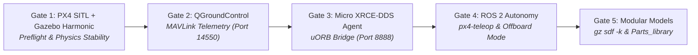

# Step 6: Smoke Test & Flight Verification

[[05 - QGroundControl Setup|← Previous: Step 5 - QGroundControl Setup]] | [[Robotics Simulation Pipeline|Pipeline MOC]] | [[07 - Sample Drone Flight|Next: Step 7 - Interactive Flight & Offboard Control →]]

---

## 📌 Overview

To verify that the complete robotics simulation pipeline is communicating properly across physical simulation, flight avionics, and ROS 2 middleware, execute the **4-Gate Verification Sequence**:



---

## 🛡️ Gate 1: Pure PX4 SITL & Gazebo Harmonic

1. Launch PX4 SITL with the standard `gz_x500` airframe:
   ```bash
   cd ~/PX4-Autopilot
   make px4_sitl gz_x500
   ```
2. Verify the `pxh>` prompt opens and model spawns level on the ground.
3. Test preflight health checks inside the `pxh>` shell:
   ```text
   pxh> commander check
   INFO  [commander] Preflight check: OK
   ```
4. Test automated takeoff and landing from the console:
   ```text
   pxh> commander takeoff
   pxh> commander land
   ```

---

## 🛡️ Gate 2: QGroundControl Telemetry

1. In a separate terminal, launch QGroundControl:
   ```bash
   ~/QGroundControl.AppImage
   ```
2. **Pass Criteria:**
   - QGC automatically connects over UDP port `14550`.
   - The artificial horizon HUD displays level pitch and roll.
   - The battery indicator, GPS lock, and flight mode indicate ready.

---

## 🛡️ Gate 3: Micro XRCE-DDS Middleware Bridge

1. Launch the Micro XRCE-DDS Agent:
   ```bash
   MicroXRCEAgent udp4 -p 8888
   ```
2. **Pass Criteria:**
   - The agent detects the PX4 client connection immediately upon startup:
     ```text
     [info] ProxyClient.cpp | create_topic | topic created | client_key: 0x00000001
     ```
   - No buffer overflows or deserialization drops occur.

---

## 🛡️ Gate 4: ROS 2 Telemetry & Offboard Teleop

1. Verify that ROS 2 can inspect published topics:
   ```bash
   ros2 topic list
   ```
   Confirm presence of:
   - `/fmu/in/offboard_control_mode`
   - `/fmu/in/trajectory_setpoint`
   - `/fmu/in/vehicle_command`
   - `/fmu/out/vehicle_local_position_v1`
   - `/fmu/out/vehicle_status_v1`

2. Run `px4-teleop` and initiate takeoff:
   ```bash
   px4-teleop
   ```
   - Press **`T`**: Vehicle arms, engages `OFFBOARD` mode, and ascends to 2.5m altitude.
   - Press **`Space`**: Locks position into a stable hover.
   - Press **`L`**: Performs controlled landing descent to the ground.

---

## 🛡️ Gate 5: Modular Model & SDFormat Verification

To verify that the modular components (`chassis`, `t_motor_f60`, `livox_mid360`, `modular_drone`) resolve cleanly via Gazebo resource paths:

```bash
cd "$HOME/Documents/PROJECTS/DC- Drone Club"

# 1. Semantic SDFormat check:
gz sdf -k Parts_library/modular_drone/model.sdf
# Expected output: Valid.

# 2. Launch modular drone simulation:
./"installed gigs"/start_sim.sh -m modular_drone
```

---

## 🚀 Unified Automated Verification

All 4 verification gates can be launched and inspected simultaneously using `start_sim.sh`:

```bash
cd ~/Documents/PROJECTS/DC-\ Drone\ Club/installed\ gigs
./start_sim.sh
```

Inspect process status at any time:
```bash
./start_sim.sh --status
```
