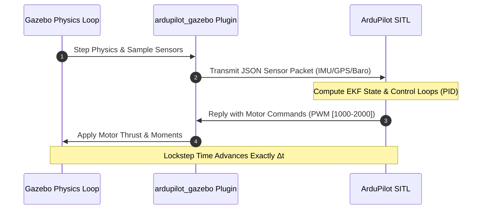

# Step 3: Build the ardupilot_gazebo Plugin

[[02 - Gazebo Harmonic Setup|← Previous: Step 2 - Gazebo Harmonic Setup]] | [[Robotics Simulation Pipeline|Pipeline MOC]] | [[04 - Shell Environment & Paths|Next: Step 4 - Shell Environment & Paths →]]

---

## 📌 Overview

The **`ardupilot_gazebo`** plugin is a custom C++ Gazebo System Plugin that connects Gazebo's physics calculation loop with ArduPilot SITL.

### Key Capabilities:
- **Lockstep Clock Synchronization**: Physics simulation steps only when ArduPilot is ready, eliminating time drift and sensor timeout false-positives.
- **Bi-directional JSON Socket**: Transmits simulated IMU, barometer, GPS, and optical flow packets to ArduPilot, and receives motor servo PWM values to actuate the Gazebo thruster/motor models.



---

## 🔨 Build Instructions

```bash
# 1. Clone the plugin repository into your home directory
cd ~
git clone https://github.com/ArduPilot/ardupilot_gazebo.git
cd ardupilot_gazebo

# 2. Explicitly specify target Gazebo version (Harmonic)
export GZ_VERSION=harmonic

# 3. Create build directory and run CMake
mkdir -p build && cd build
cmake .. -DCMAKE_BUILD_TYPE=RelWithDebInfo

# 4. Compile the plugin using all available CPU cores
make -j$(nproc)
```

---

## 🔍 Build Output Verification

Upon successful compilation, verify that the compiled shared library exists:

```bash
ls -lh ~/ardupilot_gazebo/build/libArduPilotPlugin.so
```

**Expected output:**
```plaintext
-rwxr-xr-x 1 user user ... /home/user/ardupilot_gazebo/build/libArduPilotPlugin.so
```

> [!important] Dependency Errors during CMake?
> If `cmake ..` complains about missing `gz-sim8`, verify:
> 1. You installed `libgz-sim8-dev` (on Ubuntu) or `gz-harmonic` (on Arch).
> 2. You exported `export GZ_VERSION=harmonic` before running `cmake`.

---

## ⏭️ Next Step

Proceed to [[04 - Shell Environment & Paths|Step 4: Configure Shell Environment Paths]].
