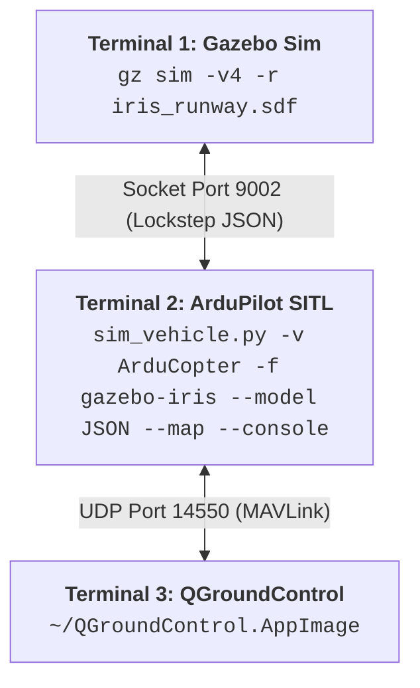

# Step 6: Smoke Test & Flight Verification

[[../05 - QGroundControl Setup|← Previous: Step 5 - QGroundControl Setup]] | [[Robotics Simulation Pipeline|Pipeline MOC]] | [[Quick Reference & Launch Script (ArduPilot)|Next: Quick Reference & Script →]]

---

## 📌 Overview

To verify that the complete robotics simulation pipeline is communicating properly, launch the three processes across **three separate terminal windows** (or tmux panes).



---

## 🚀 Execution Steps

### Terminal 1: Launch Gazebo with the Iris Runway World

Start Gazebo Sim rendering the world with physics unpaused (`-r`):

```bash
gz sim -v4 -r iris_runway.sdf
```

> [!note] What happens in Terminal 1
> - Gazebo opens the 3D runway environment.
> - The Iris quadcopter model is spawned with the `ardupilot_gazebo` plugin attached.
> - The simulation listens for SITL connection on the local JSON socket.

---

### Terminal 2: Launch ArduPilot SITL (Gazebo JSON Interface)

Open a second terminal, navigate to the copter vehicle directory, and start SITL:

```bash
cd ~/ardupilot/ArduCopter
sim_vehicle.py -v ArduCopter -f gazebo-iris --model JSON --map --console
```

> [!important] Flag breakdown:
> - `-v ArduCopter`: Vehicle type is multirotor.
> - `-f gazebo-iris`: Frame configuration matching the Gazebo Iris model.
> - `--model JSON`: Selects the JSON socket backend matching `ardupilot_gazebo`.
> - `--map --console`: Launches the MAVProxy graphical telemetry console and live GPS map.

#### ⏳ Wait for EKF & Arming Pass
Monitor the MAVProxy console until the following lines appear:
```plaintext
EKF3 IMU0 is using GPS
EKF3 IMU1 is using GPS
AP: Arming checks PASS
```

---

### Terminal 3: Launch QGroundControl

In the third terminal, launch the GCS:

```bash
~/QGroundControl.AppImage
```

**Expected telemetry confirmation:**
- QGroundControl will automatically listen on UDP port `14550`.
- The voice prompt will announce: *"Connected to Vehicle 1"*.
- The primary flight display will indicate current GPS coordinates and "Disarmed" status.

---

## 🚁 4. Motor Actuation & Autonomous Takeoff Test

In **Terminal 2 (the MAVProxy interactive console)**, execute the following commands to command the drone:

```plaintext
STABILIZE> mode guided
GUIDED> arm throttle
GUIDED> takeoff 5
```

### Expected Visual and Telemetry Results:
1. **Audible / Console feedback**:
   - `ARMED` notification in MAVProxy and QGroundControl.
2. **In Gazebo 3D Viewport**:
   - The quadcopter's four rotors spin up.
   - The Iris quadcopter lifts off from the runway and climbs vertically.
   - The drone halts and hovers steadily at exactly **5.0 meters AGL** (Above Ground Level).
3. **In QGroundControl**:
   - The artificial horizon reflects lift and altitude climbs to 5.0 m.

---

## 🛑 Safe Shutdown Sequence

To stop simulation gracefully:
1. In **Terminal 2 (MAVProxy)**: Type `exit` or press `Ctrl + C`.
2. In **Terminal 1 (Gazebo)**: Press `Ctrl + C` or close the window.
3. In **Terminal 3 (QGroundControl)**: Close the application.

---

## ⏭️ Next Step

Check out the [[Quick Reference & Launch Script|Launch Automation Script & Command Reference]].
