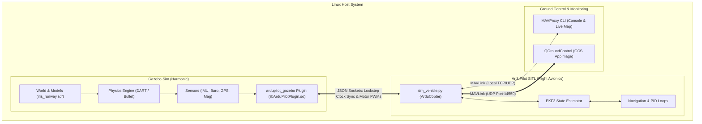

# 📦 Old Simulation Stack: ArduPilot SITL + Gazebo Harmonic (Archived)

> [!warning] Architectural Status: Archived & Decommissioned
> This directory archives the documentation for the **original ArduPilot simulation stack**. 
> The active production simulation pipeline has migrated to **PX4 Autopilot (v1.17) + Gazebo Harmonic (8.15.0) + Micro XRCE-DDS + ROS 2 (Humble)**.
> - **Active Pipeline Hub**: [[Robotics Simulation Pipeline|Robotics Simulation Pipeline (MOC)]]
> - **Migration Ledger**: [[PX4 ROS2 Migration Ledger|ArduPilot to PX4 + ROS 2 Migration Ledger]]
> - **Launch Automation**: [[Quick Reference & Launch Script|start_sim.sh & px4-teleop Cheat Sheet]]

---

## 🗺️ Legacy Architecture Overview

The previous stack relied on ArduPilot's Software In The Loop (SITL) firmware communicating with Gazebo through a third-party C++ lockstep plugin and MAVLink proxy bridges:

---

## 📚 Archived Documentation Index

The original guides for setting up and running the ArduPilot stack are preserved below:

1. **[[01 - ArduPilot SITL Setup|Step 1: ArduPilot SITL Setup]]**
   - Git submodules, toolchain installation (`install-prereqs-arch.sh`), and `sim_vehicle.py`.
2. **[[02 - Gazebo Harmonic Setup (ArduPilot)|Step 2: Gazebo Harmonic Setup (ArduPilot)]]**
   - OSRF repositories, `gz-harmonic`, media libraries, and Bullet Featherstone config.
3. **[[03 - ardupilot_gazebo Plugin|Step 3: ardupilot_gazebo Plugin]]**
   - Building the custom C++ JSON socket lockstep plugin (`libArduPilotPlugin.so`).
4. **[[04 - Shell Environment & Paths|Step 4: Shell Environment & Paths]]**
   - Setting `GZ_SIM_SYSTEM_PLUGIN_PATH`, `GZ_SIM_RESOURCE_PATH`, and ArduPilot autotest paths.
5. **[[06 - Smoke Test & Flight Verification (ArduPilot)|Step 6: Smoke Test & Flight Verification (ArduPilot)]]**
   - Multi-terminal launch sequence (Gazebo, `sim_vehicle.py -v ArduCopter -f gazebo-iris`, QGC), arming, and guided takeoff.
6. **[[Quick Reference & Launch Script (ArduPilot)|Quick Reference & Launch Script (ArduPilot)]]**
   - Original 3-pane tmux launcher and MAVProxy command cheat sheet.

---

## 📜 Preserved Legacy Code
- The original guided mission flight script (`sample_drone_flight.py`) is preserved in the repository at:
  [`../../../legacy_ardupilot/sample_drone_flight.py`](../../../legacy_ardupilot/sample_drone_flight.py)

---

## ⏭️ Active Pipeline Reference
To work with the modern active stack, visit:
- [[01 - PX4 Autopilot SITL Setup|Step 1: PX4 Autopilot SITL Setup]]
- [[02 - Gazebo Harmonic Setup|Step 2: Gazebo Harmonic Setup & Physics Stabilization]]
- [[03 - Micro XRCE-DDS & ROS 2 Setup|Step 3: Micro XRCE-DDS Middleware & ROS 2 Autonomy]]
- [[04 - Shell Environment & Launch Automation|Step 4: Shell Environment & Launch Automation]]
- [[06 - Smoke Test & Flight Verification|Step 6: 4-Gate Smoke Test & Flight Verification]]
- [[07 - Sample Drone Flight|Step 7: Sample Drone Flight & ROS 2 Autonomy (`px4-teleop`)]]
- [[08 - Performance & Troubleshooting Guide|Step 8: Performance & Troubleshooting Guide]]
