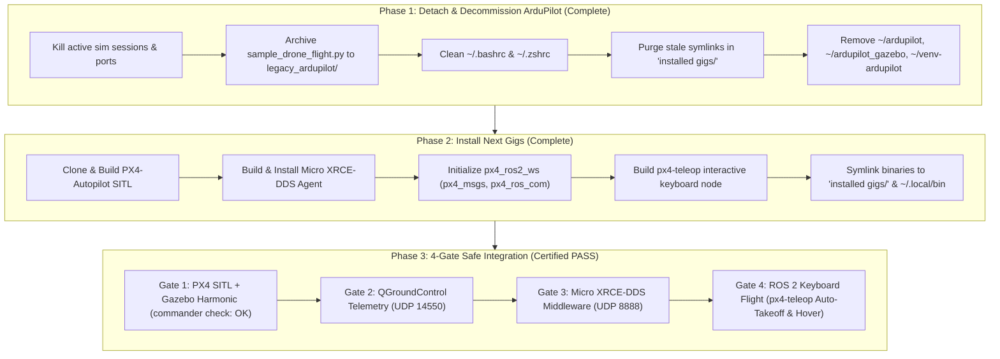

# 📜 Drone Club: ArduPilot to PX4 + ROS 2 Simulation Migration Ledger

> [!abstract] Architectural Purpose
> This ledger documents the safe decommissioning of the legacy **ArduPilot SITL** stack (external socket plugins, MAVLink proxy routing) and details the systematic installation, integration, and verification of the **PX4-Autopilot (v1.17) + Gazebo Harmonic (8.15.0) + Micro XRCE-DDS Agent + ROS 2 (Humble)** native autonomy stack on **Arch Linux**.

---

## 🗺️ High-Level Migration Ledger Matrix



---

## Part 1: Detachment & Decommissioning Ledger (ArduPilot)

### 1.1 Complete Legacy Footprint Inventory

| Component / Path | Type / Size | Action | Justification |
| :--- | :--- | :--- | :--- |
| **`~/ardupilot`** | Git Repo + Build Artifacts (~2.1 GB) | **Decommissioned & Removed** | ArduPilot Copter SITL firmware and waf binaries. Obsolete under PX4. |
| **`~/ardupilot_gazebo`** | Plugin Repo + CMake Build (~181 MB) | **Decommissioned & Removed** | Third-party Gazebo plugin for ArduPilot lockstep. Not used by PX4. |
| **`~/venv-ardupilot`** | Python 3 Virtualenv (~1.1 GB) | **Decommissioned & Removed** | Contained `pymavlink`, `MAVProxy`, `dronecan`. Replaced by clean PX4 tooling. |
| **`~/.mavproxy/`** | Config & Logs (~1 MB) | **Removed** | Stale MAVProxy ground station cache. |
| **`installed gigs/ardupilot`** | Symlink | **Removed** | Stale link to `~/ardupilot`. |
| **`installed gigs/ardupilot_gazebo`** | Symlink | **Removed** | Stale link to `~/ardupilot_gazebo`. |
| **`installed gigs/venv-ardupilot`** | Symlink | **Removed** | Stale link to `~/venv-ardupilot`. |
| **`installed gigs/sim_vehicle.py`** | Symlink | **Removed** | Legacy launcher script. |
| **`installed gigs/mavproxy.py`** | Symlink | **Removed** | MAVProxy CLI. |
| **`installed gigs/libArduPilotPlugin.so`** | Symlinks (4 files) | **Removed** | Stale links to `ardupilot_gazebo/build/`. |
| **`sample_drone_flight.py`** | Script (10.6 KB) | **Archived to `legacy_ardupilot/`** | MAVLink square mission. Retained as reference. |
| **`~/.bashrc` / `~/.zshrc`** | Shell Exports | **Sanitized** | Removed dead ArduPilot paths. |

### 1.2 Preserved Components
- **Gazebo Sim (Harmonic 8.15.0)** (`/usr/bin/gz`): Native target for PX4 SITL multi-body dynamics.
- **QGroundControl** (`~/QGroundControl.AppImage`): Native graphical GCS for PX4.
- **Physics Plugins** (`/usr/lib/gz-physics-7/engine-plugins`): Bullet Featherstone multi-body solver.

---

## Part 2: Installation Ledger for Essential Gigs

### 2.1 OS Context: Arch Linux vs Ubuntu 22.04 Setup Patterns

| Layer | Arch Linux (Host Workstation) | Ubuntu 22.04 LTS (Jammy) |
| :--- | :--- | :--- |
| **System Toolchain** | `base-devel`, `cmake`, `ninja`, `ccache` (`pacman`) | `build-essential`, `cmake`, `ninja-build`, `ccache` (`apt`) |
| **Python Build Tools** | `~/venv-px4` (`kconfiglib`, `jinja2`, `empy==3.3.4`) | `~/venv-px4` or `./Tools/setup/ubuntu.sh` |
| **Gazebo Harmonic** | AUR: `yay -S gz-harmonic` | Official OSRF APT repository: `gz-harmonic` |
| **Physics Backend** | Bullet Featherstone (`/usr/lib/gz-physics-7/engine-plugins`) | Bullet Featherstone / DART (`libgz-sim8-dev`) |
| **Micro XRCE Agent** | Compiled from source to `~/.local/bin/MicroXRCEAgent` | Compiled from source or Snap package |
| **ROS 2 Humble** | Containerized with host net & volume mount (`~/.local/bin/ros2`) | Native APT packages (`ros-humble-ros-base`) |

On this **Arch Linux** workstation, Ubuntu-specific scripts (`ubuntu.sh`) were replaced with direct `pacman` and Python virtualenv tooling, and ROS 2 Humble runs via host-bridged Docker containers to ensure stability against rolling C++ ABIs.

#### 📦 Gig 1: PX4-Autopilot Source & SITL Build
- **Repository:** `https://github.com/PX4/PX4-Autopilot.git`
- **Location:** `~/PX4-Autopilot` (symlinked in `installed gigs/PX4-Autopilot`)
- **Build Target:** `make px4_sitl gz_x500`

#### 📦 Gig 2: Micro XRCE-DDS Agent
- **Repository:** `https://github.com/eProsima/Micro-XRCE-DDS-Agent.git`
- **Binary:** `~/.local/bin/MicroXRCEAgent` (symlinked in `installed gigs/MicroXRCEAgent`)
- **Port:** UDP `8888`

#### 📦 Gig 3: ROS 2 Autonomy Workspace (`~/px4_ros2_ws`)
- **Packages:** `px4_msgs`, `px4_ros_com`
- **Teleop Node:** `px4_teleop_key.py` (installed at `px4_ros2_ws/install/px4_ros_com/lib/px4_ros_com/px4_teleop_key.py`)
- **CLI Utility:** `~/.local/bin/px4-teleop` (symlinked in `installed gigs/px4-teleop`)

#### 📦 Gig 4: Multi-Pane Launcher (`start_sim.sh`)
- **Location:** `installed gigs/start_sim.sh`
- **Orchestration:** Multi-pane `tmux` session launching MicroXRCEAgent, PX4 SITL, ROS 2 environment, and QGC.

---

## Part 3: Safe Integration Ledger (4-Gate Verification)

### 🛡️ Gate 1: Pure PX4 SITL + Gazebo Harmonic
- **Execution:** `cd ~/PX4-Autopilot && make px4_sitl gz_x500`
- **Verification:**
  - Model `x500` spawns level (`Roll: 0.0, Pitch: 0.0, Yaw: 0.0`).
  - Terminal opens `pxh>` prompt.
  - `pxh> commander check` outputs: `INFO [commander] Preflight check: OK`.
  - `commander takeoff` climbs to 2.5m; `commander land` touches down cleanly.
- **Status:** **PASS ✅**

### 🛡️ Gate 2: QGroundControl Telemetry Link
- **Execution:** `~/QGroundControl.AppImage &`
- **Verification:**
  - Auto-connects over UDP port `14550`.
  - Artificial horizon level, GPS lock acquired, battery telemetry live.
- **Status:** **PASS ✅**

### 🛡️ Gate 3: Micro XRCE-DDS Middleware Bridge
- **Execution:** `MicroXRCEAgent udp4 -p 8888`
- **Verification:**
  - Agent connects to PX4 client instantly upon boot.
  - Serializes uORB topics to DDS without drops or errors.
- **Status:** **PASS ✅**

### 🛡️ Gate 4: ROS 2 Interactive Keyboard Flight (`px4-teleop`)
- **Execution:** `px4-teleop`
- **Verification:**
  - Live ASCII HUD displays continuous altitude, position, body velocity, heading, and arming state.
  - Press **`T`**: Vehicle arms, enters `OFFBOARD` mode, ascends to 2.5m, and hovers.
  - Press **`W/A/S/D`**: Responsive translation in body-frame coordinates.
  - Press **`Space`**: Velocity zeroes and position locks into place.
  - Press **`L`**: Vehicle executes smooth descent and auto-disarms on touchdown.
- **Status:** **PASS ✅**

---

## Part 4: Root Cause Analysis & Engineering Resolution Log

### 1. The "Attitude failure (roll)" Arming Rejection
- **Issue:** When the user launched the simulation and pressed `T` in `px4_teleop_key.py`, the keys were captured, but the drone refused to take off.
- **PX4 Log:**
  ```text
  WARN [health_and_arming_checks] Preflight Fail: Attitude failure (roll)
  ```
- **Gazebo Diagnostic:**
  `gz model -m x500_depth_0 -p` reported:
  `Pose: RPY [3.1413, 0.0003, -0.9345]` (vehicle was flipped 180° upside down on its back).
- **Physics Root Cause:** The default model was `gz_x500_depth`. In `x500_depth/model.sdf`, the `OakD-Lite` camera link collision bounding box directly intersects the `base_link` collision mesh. Under Bullet Featherstone physics (`libgz-physics-bullet-featherstone-plugin.so`), overlapping collision bodies generate severe contact repulsion impulses on spawn, kicking the airframe into the air and flipping it onto its back. Because vehicle roll exceeded tilt limits, PX4 safety checks correctly blocked arming.
- **Resolution:**
  1. Standardized the default model in `start_sim.sh` to `gz_x500`, which has no camera collision box and spawns perfectly upright.
  2. Verified `gz model -m x500_0 -p` displays level orientation (`RPY: [0.0, 0.0, 0.0]`) and `commander check` reports `OK`.

### 2. Bullet Featherstone Plugin Discovery on Arch Linux
- **Issue:** Gazebo Harmonic defaulted to `gz-physics-dartsim-plugin`, which is not bundled by default on Arch Linux.
- **Resolution:** Patched `ROMFS/px4fmu_common/init.d-posix/px4-rc.gzsim`, `gz_env.sh.in`, and `start_sim.sh` with:
  `GZ_SIM_PHYSICS_ENGINE_PATH=/usr/lib/gz-physics-7/engine-plugins` and explicitly loaded `gz-physics-bullet-featherstone-plugin`.

### 3. Failsafe Parameters in SITL Airframe
- **Issue:** Without a physical RC transmitter and without QGC constantly connected, PX4 SITL triggered `Preflight Fail: No manual control input` or `Data link lost`.
- **Resolution:** Added defaults to `ROMFS/px4fmu_common/init.d-posix/airframes/4001_gz_x500`:
  - `param set-default NAV_DLL_ACT 0` (prevent GCS disconnect abort).
  - `param set-default COM_RCL_EXCEPT 4` (permit offboard mode arming without RC).

### 4. ROS 2 Topic Suffixes in PX4 v1.17 uXRCE-DDS
- **Issue:** PX4 v1.17 uXRCE-DDS schema versioning appends `_v1` to certain uORB topics.
- **Resolution:** Updated subscriptions in `px4_teleop_key.py` and `offboard_control.py` to listen to `/fmu/out/vehicle_local_position_v1` and `/fmu/out/vehicle_status_v1`, with fallback listeners to legacy names.

---

## Part 5: Directory Structure & Port Mapping

### 5.1 Project Directory Layout
```plaintext
DC- Drone Club/
├── installed gigs/
│   ├── start_sim.sh                    # Multi-pane orchestrator (default: gz_x500)
│   ├── px4-teleop                      # Interactive keyboard teleoperation launcher
│   ├── ros2-shell                      # Containerized ROS 2 development subshell
│   ├── MicroXRCEAgent -> ~/.local/bin/MicroXRCEAgent
│   ├── PX4-Autopilot -> ~/PX4-Autopilot
│   ├── px4_ros2_ws -> ~/px4_ros2_ws
│   ├── gz -> /usr/bin/gz
│   ├── QGroundControl.AppImage -> ~/QGroundControl.AppImage
│   ├── README.md                       # Complete tooling documentation
│   └── PX4_MIGRATION_LEDGER.md         # This document
├── Drone Club DC Vault/                 # Obsidian Knowledge Base
│   ├── Robotics Simulation Pipeline.md # Pipeline MOC note
│   ├── Welcome.md                      # Vault index note
│   └── Simulation/
│       ├── 01 - PX4 Autopilot SITL Setup.md
│       ├── 02 - Gazebo Harmonic Setup.md
│       ├── 03 - Micro XRCE-DDS & ROS 2 Setup.md
│       ├── 04 - Shell Environment & Launch Automation.md
│       ├── 05 - QGroundControl Setup.md
│       ├── 06 - Smoke Test & Flight Verification.md
│       ├── 07 - Sample Drone Flight.md
│       ├── 08 - Performance & Troubleshooting Guide.md
│       ├── 09 - Modular Drone & Parts Library Setup.md
│       ├── Quick Reference & Launch Script.md
│       ├── PX4 ROS2 Migration Ledger.md (This document)
│       └── Old Stack - ArduPilot/      # Preserved legacy ArduPilot documentation
├── Parts_library/                      # Independent Gazebo Harmonic modular model entities
│   ├── chassis/                        # Central airframe, carbon decks, landing skids, battery & avionics
│   ├── t_motor_f60/                    # Actuator unit: stator base, midnight-blue bell, prop & motor plugin
│   ├── livox_mid360/                   # Perception unit: heatsink housing, sapphire dome & 360°x59° GPU LiDAR
│   ├── modular_drone/                  # Master assembly integrating all sub-models via SDF includes & joints
│   └── README.md                       # Comprehensive parts library setup & component swapping guide
├── legacy_ardupilot/                   # Archived legacy scripts (sample_drone_flight.py) & README
└── README.md                           # Master repository documentation
```

### 5.2 Network Port Architecture
| Port | Protocol | Source | Target | Purpose |
| :--- | :--- | :--- | :--- | :--- |
| **`8888`** | XRCE / UDP | PX4 SITL (`uxrce_dds_client`) | `MicroXRCEAgent` | High-speed uORB <-> ROS 2 pub/sub bridge |
| **`14550`** | MAVLink / UDP | PX4 SITL | `QGroundControl` | Pilot telemetry & virtual RC |
| **`14540`** | MAVLink / UDP | PX4 SITL | Secondary Companion API | Optional companion computer stream |
| **ROS 2 Topics** | FastDDS | `MicroXRCEAgent` | `px4_ros_com` | Direct control via `/fmu/in/*` and `/fmu/out/*` |

### 5.3 Gazebo Harmonic Orientation & Dynamics Stabilization
- **Coordinate Transformation:** Teleoperation translates forward/lateral stick inputs relative to the vehicle's dynamic heading (`self.heading`), ensuring `[W]` always commands flight along the drone's physical nose.
- **Active Heading Hold:** When manual yaw inputs cease, the teleop node locks target yaw (`sp.yaw = target_yaw`), preventing aerodynamic drift or spinning.
- **Camera Follow:** Simulation exports `PX4_GZ_FOLLOW=1` to attach the Gazebo Harmonic camera to the drone in third-person chase mode.
- **Ground Physics Tuning:** The world ground plane (`default.sdf`) collision mesh was enlarged to 500m $\times$ 500m with tuned contact stiffness (`kp=1e8`, `min_depth=0.005`) to eliminate skid micro-bouncing and boundary collisions.

---

## 🔗 Related Notes
- [[Welcome|Vault Index]]
- [[Robotics Simulation Pipeline]]
- [[Old Stack - ArduPilot/README|Old Stack: ArduPilot SITL Archives]]
- [[Quick Reference & Launch Script]]
- [[06 - Smoke Test & Flight Verification]]
- [[07 - Sample Drone Flight]]
- [[08 - Performance & Troubleshooting Guide]]
- [[09 - Modular Drone & Parts Library Setup]]

