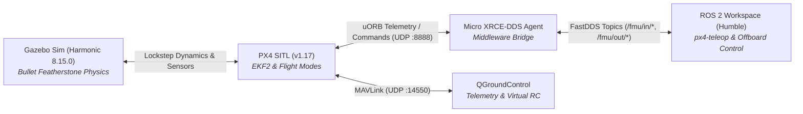

# Welcome to the Drone Club Knowledge Base 🛸

Welcome to the central knowledge repository for **Drone Club (DC)**. This vault documents our robotics engineering workflows, autonomous flight avionics, simulation environments, and physical UAV hardware builds.

---

## 🧭 Core Maps of Content (MOCs)

### 🛩️ Simulation & Autonomy (PX4 + ROS 2 + Gazebo Harmonic)
- [[Robotics Simulation Pipeline|Robotics Simulation Pipeline (MOC)]]: The master architectural guide for autonomous flight simulation (PX4 v1.17 + Gazebo Harmonic + Micro XRCE-DDS + ROS 2).
- [[Quick Reference & Launch Script|Launch Automation & Flight Controls Cheat Sheet]]: Guide to `start_sim.sh`, `px4-teleop`, key mappings, and CLI options.
- [[PX4 ROS2 Migration Ledger|ArduPilot to PX4 + ROS 2 Migration Ledger]]: Complete record of the decommissioning of legacy ArduPilot and installation of native PX4 ROS 2.
- [[implementationplan|Simulation Architecture & Implementation Roadmap]]: Core milestones and roadmap.
- [[Master Overview|Vault Master Overview (README)]]: High-level stack overview and dataflow diagram.

#### 📚 10-Step Step-by-Step Pipeline Guides:
0. [[00 - Day One Zero-to-Hero Quickstart|Step 0: Day One Zero-to-Hero Quickstart & Installation (Beginner Walkthrough)]]
1. [[01 - PX4 Autopilot SITL Setup|Step 1: PX4 Autopilot SITL Setup]]
2. [[02 - Gazebo Harmonic Setup|Step 2: Gazebo Sim (Harmonic) Setup & Physics Stabilization]]
3. [[03 - Micro XRCE-DDS & ROS 2 Setup|Step 3: Micro XRCE-DDS Middleware & ROS 2 Autonomy Setup]]
4. [[04 - Shell Environment & Launch Automation|Step 4: Configure Shell Environment & Launch Automation]]
5. [[05 - QGroundControl Setup|Step 5: QGroundControl Setup (Virtual Telemetry & RC)]]
6. [[06 - Smoke Test & Flight Verification|Step 6: 4-Gate Smoke Test & System Verification]]
7. [[07 - Sample Drone Flight|Step 7: Interactive Keyboard Flight (`px4-teleop`) & Offboard Control]]
8. [[08 - Performance & Troubleshooting Guide|Step 8: Performance & Troubleshooting Runbooks]]
9. [[09 - Modular Drone & Parts Library Setup|Step 9: Modular Drone & Parts Library Architecture (PX4, MRS, Livox & RotorS Lineage)]]

#### 📦 Model Libraries & Tooling Notes:
- [[09 - Modular Drone & Parts Library Setup|Modular Parts Library Guide]] ([`../Parts_library/`](../Parts_library)): Self-contained Gazebo Harmonic modular entities (`chassis`, `t_motor_f60`, `livox_mid360`, `modular_drone`).
- [[Gazebo_Modular_Drone_Architecture|Gazebo Modular Architecture & SDF Engineering Reference]]: Custom C++ lifecycle plugins (`CustomDronePlugin`), assembly models, and CAD/Blender-to-SDF conversion pipeline.
- [[Installed Gigs & Simulation Tooling|Installed Gigs & Simulation Tooling Reference]] ([`../installed gigs/`](../installed%20gigs/)): Shortcuts, symlinks, and runtimes.
- [[Old Stack - ArduPilot/README|Old Stack: ArduPilot SITL + Gazebo Harmonic (Archived)]]

---

## 🔗 Architecture At a Glance

---
*Tip: In Obsidian, press `Ctrl + O` (or `Cmd + O`) to search notes by name, and `Ctrl + G` to view the interactive graph of note connections.*