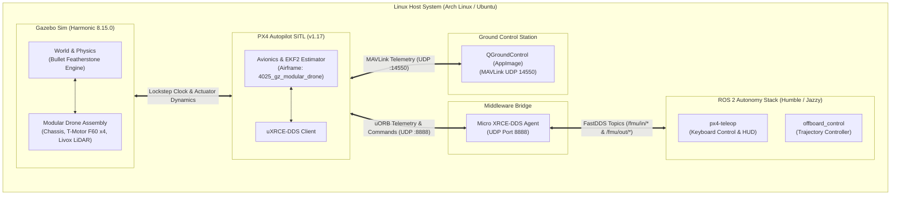

# Drone Club Autonomous Simulation & Flight Stack 🛸

A high-performance, modular robotics simulation and autonomous avionics pipeline integrating **PX4 Autopilot (v1.17)**, **Gazebo Harmonic (8.15.0)** with **Bullet Featherstone Physics**, **Micro XRCE-DDS**, and **ROS 2 (Jazzy / Humble)** on Linux (Arch Linux & Ubuntu 22.04 / 24.04 LTS).

The stack is coupled with an engineering knowledge base located in [`Drone Club DC Vault/`](Drone%20Club%20DC%20Vault), maintaining bidirectional links between physical CAD/SDF assemblies, simulation runbooks, and control software.

---

## 🧭 Table of Contents
1. [🧠 Obsidian Engineering Knowledge Base](#-obsidian-engineering-knowledge-base)
2. [⚡ Quick Start & System Doctor](#-quick-start--system-doctor)
3. [🧩 Modular Drone & Parts Library](#-modular-drone--parts-library)
4. [📦 OS Prerequisites & ROS 2 Setup](#-os-prerequisites--ros-2-setup)
5. [🚀 Launching & Flying the Drone](#-launching--flying-the-drone)
6. [🏗️ Architecture & Dataflow](#️-architecture--dataflow)
7. [📁 Repository Structure](#-repository-structure)
8. [🎮 Key Controls Reference (`px4-teleop`)](#-key-controls-reference-px4-teleop)
9. [⚙️ Git & Workspace Synchronization Policy](#️-git--workspace-synchronization-policy)

---

## 🧠 Obsidian Engineering Knowledge Base

All technical documentation, architectural decision records, and operational guides are maintained as a connected knowledge graph within [`Drone Club DC Vault/`](Drone%20Club%20DC%20Vault).

### 🚀 Fast Navigation & Master Maps of Content (MOC)
- **Vault Index & Launchpad**: [`Drone Club DC Vault/Welcome.md`](Drone%20Club%20DC%20Vault/Welcome.md) — Fast entry point and search shortcuts.
- **Master Engineering Pipeline (MOC)**: [`Drone Club DC Vault/Robotics Simulation Pipeline.md`](Drone%20Club%20DC%20Vault/Robotics%20Simulation%20Pipeline.md) — Master map of content linking all avionics, simulation, and hardware modules.
- **Vault Master Overview**: [`Drone Club DC Vault/Master Overview.md`](Drone%20Club%20DC%20Vault/Master%20Overview.md) — High-level architecture and quickstart summary.
- **Migration Ledger**: [`Drone Club DC Vault/Simulation/PX4 ROS2 Migration Ledger.md`](Drone%20Club%20DC%20Vault/Simulation/PX4%20ROS2%20Migration%20Ledger.md) — Historical audit log of the transition from ArduPilot to PX4 + ROS 2.

### 📚 10-Step Robotics Curriculum & Simulation Runbooks
| Step | Module / Note | Description |
| :---: | :--- | :--- |
| **00** | [`00 - Day One Zero-to-Hero Quickstart`](Drone%20Club%20DC%20Vault/Simulation/00%20-%20Day%20One%20Zero-to-Hero%20Quickstart.md) | Step-by-step onboarding guide for fresh Linux setups and new club members. |
| **01** | [`01 - PX4 Autopilot SITL Setup`](Drone%20Club%20DC%20Vault/Simulation/01%20-%20PX4%20Autopilot%20SITL%20Setup.md) | Compiling and configuring PX4 v1.17 SITL target for Gazebo Harmonic. |
| **02** | [`02 - Gazebo Harmonic Setup`](Drone%20Club%20DC%20Vault/Simulation/02%20-%20Gazebo%20Harmonic%20Setup.md) | Gazebo Sim 8.15.0 installation, Bullet Featherstone physics engine tuning, and SDF schemas. |
| **03** | [`03 - Micro XRCE-DDS & ROS 2 Setup`](Drone%20Club%20DC%20Vault/Simulation/03%20-%20Micro%20XRCE-DDS%20%26%20ROS%202%20Setup.md) | FastDDS middleware bridging PX4 uORB messaging to ROS 2 topics (`/fmu/in/*`, `/fmu/out/*`). |
| **04** | [`04 - Shell Environment & Launch Automation`](Drone%20Club%20DC%20Vault/Simulation/04%20-%20Shell%20Environment%20%26%20Launch%20Automation.md) | Environment exports (`GZ_SIM_RESOURCE_PATH`), aliases, and tmux orchestration scripts. |
| **05** | [`05 - QGroundControl Setup`](Drone%20Club%20DC%20Vault/Simulation/05%20-%20QGroundControl%20Setup.md) | QGroundControl AppImage setup, MAVLink UDP port 14550 routing, and parameter tuning. |
| **06** | [`06 - Smoke Test & Flight Verification`](Drone%20Club%20DC%20Vault/Simulation/06%20-%20Smoke%20Test%20%26%20Flight%20Verification.md) | 4-gate verification checklist: physics lockstep, DDS uORB bridge, MAVLink telemetry, and motor arming. |
| **07** | [`07 - Sample Drone Flight`](Drone%20Club%20DC%20Vault/Simulation/07%20-%20Sample%20Drone%20Flight.md) | Autonomous trajectory control and interactive keyboard flight with `px4-teleop`. |
| **08** | [`08 - Performance & Troubleshooting Guide`](Drone%20Club%20DC%20Vault/Simulation/08%20-%20Performance%20%26%20Troubleshooting%20Guide.md) | Diagnostic runbooks for RTF degradation, missing physics plugins, DDS packet drops, and EKF2 divergence. |
| **09** | [`09 - Modular Drone & Parts Library Setup`](Drone%20Club%20DC%20Vault/Simulation/09%20-%20Modular%20Drone%20%26%20Parts%20Library%20Setup.md) | Kinematic assembly, CAD-to-SDF conversion, Livox LiDAR integration, and actuator plugin multiplexing. |

### 🛠️ Reference Notes & Tooling Documentation
- [`Installed Gigs & Simulation Tooling`](Drone%20Club%20DC%20Vault/Simulation/Installed%20Gigs%20%26%20Simulation%20Tooling.md) — Detailed reference for launchers, symlinks, and aliases in [`installed gigs/`](installed%20gigs/).
- [`Gazebo Modular Drone Architecture`](Drone%20Club%20DC%20Vault/Simulation/Gazebo_Modular_Drone_Architecture.md) — Low-level C++ plugin specifications and multi-model SDFormat composition rules.
- [`Quick Reference & Launch Script`](Drone%20Club%20DC%20Vault/Simulation/Quick%20Reference%20%26%20Launch%20Script.md) — Cheatsheet for tmux panes, keybindings, and command-line flags.
- [`Old Stack - ArduPilot Archive`](Drone%20Club%20DC%20Vault/Simulation/Old%20Stack%20-%20ArduPilot/README.md) — Preserved documentation for legacy ArduPilot SITL setup.

### 🌐 Connecting to the Obsidian Vault
1. Launch **Obsidian**.
2. Select **"Open folder as vault"**.
3. Choose the directory:
   ```plaintext
   /home/gytdrop/Documents/PROJECTS/DC- Drone Club/Drone Club DC Vault
   ```
4. **Graph View Configuration**:
   The vault includes preconfigured graph settings (`.obsidian/graph.json`) with semantic color groups:
   - 🔴 **`#moc`** (Red): Master Map of Content notes.
   - 🔵 **`#simulation`** (Blue): Core PX4 & Gazebo simulation runbooks.
   - 🟢 **`#tools`** (Green): Launch scripts, tmux automation, and CLI utilities.
   - 🟣 **`#modular`** (Purple): Modular drone, parts library, and CAD models.
   - 🟡 **`#beginner`** (Yellow): Onboarding and quickstart guides.
   - ⚪ **`#migration`** / **`#archive`** (Gray): Historical records and legacy ArduPilot docs.

---

## ⚡ Quick Start & System Doctor

### 1. Automated System Setup (`setup_modular_drone.sh`)
The root script [`setup_modular_drone.sh`](setup_modular_drone.sh) automates dependency management, symlink integrity, PX4 airframe provisioning, and runs a comprehensive **56-point diagnostic doctor**:

```bash
# Option A: Run 56-point diagnostic doctor (safe, non-destructive audit)
./setup_modular_drone.sh

# Option B: Turnkey install & auto-configure on a fresh Linux PC
./setup_modular_drone.sh --all

# Option C: Auto-configure links, airframe & shell profiles (if tools are already installed)
./setup_modular_drone.sh --fix

# Option D: Launch 3D Gazebo standalone model preview (with ground & lighting)
./setup_modular_drone.sh --preview

# Option E: Launch the full multi-pane simulation stack directly
./setup_modular_drone.sh --launch
```

#### CLI Options for `setup_modular_drone.sh`:
| Flag | Description |
| :--- | :--- |
| `-a, --all` | Turnkey install: installs OS packages (`apt`/`pacman`), fetches QGC/PX4, links models, configures shell. |
| `-f, --fix` | Auto-resolves missing symlinks, airframe `4025_gz_modular_drone`, and shell exports (`~/.bashrc`, `~/.zshrc`). |
| `-i, --install-deps` | Installs system packages according to your detected OS (Ubuntu or Arch Linux). |
| `--validate-only` | Runs silent 56-point diagnostic checks and exits with `0` (pass) or `1` (fail) for CI/CD pipelines. |
| `-p, --preview` | Spawns the modular drone directly inside standalone Gazebo Sim 3D GUI with Bullet Featherstone physics. |
| `-l, --launch` | Starts the multi-pane tmux flight stack (`start_sim.sh -m modular_drone`). |

---

## 🧩 Modular Drone & Parts Library

The project features a component-based modular drone assembly located in [`Parts_library/`](Parts_library):

```plaintext
Parts_library/
├── chassis/                 # Center airframe, avionics bay & structural carbon arms
├── t_motor_f60/             # T-Motor F60 Pro IV brushless motors & 5146 props
├── livox_mid360/            # Livox Mid-360 3D LiDAR sensor model
├── modular_drone/           # Top-level kinematic assembly linking all sub-models
├── preview_world.sdf        # Standalone inspection world with Bullet Featherstone physics
└── README.md                # Component design & SDFormat composition specs
```

### 🎯 Key Engineering Innovations:
1. **Actuator Multiplexing**: Top-level `MulticopterMotorModel` plugins declared in `modular_drone/model.sdf` listening on `/modular_drone/command/motor_speed` with actuators 0–3, overcoming Gazebo Harmonic sub-model topic isolation.
2. **PX4 Airframe Integration**: Integrated as airframe `4025_gz_modular_drone` inside `PX4-Autopilot/ROMFS/px4fmu_common/init.d-posix/airframes/`.
3. **Physics Stability**: Tuned for **Bullet Featherstone (`gz-physics-bullet-featherstone-plugin`)**, eliminating constraint instability and providing smooth real-time flight on Arch Linux and Ubuntu.
4. **C++ Plugin Stack**: Custom system lifecycle plugin in [`plugins/custom_drone_plugin/`](plugins/custom_drone_plugin/) compiled automatically during setup.

---

## 📦 OS Prerequisites & ROS 2 Setup

### 🐧 Ubuntu 24.04 LTS (Noble Numbat) — ROS 2 Jazzy Jalisco
```bash
# 1. Set UTF-8 locale & install base utilities
sudo apt update && sudo apt install -y locales software-properties-common curl
sudo locale-gen en_US en_US.UTF-8
sudo update-locale LC_ALL=en_US.UTF-8 LANG=en_US.UTF-8
export LANG=en_US.UTF-8

# 2. Add ROS 2 repository & GPG key
sudo add-apt-repository universe -y
sudo curl -sSL https://raw.githubusercontent.com/ros/rosdistro/master/ros.key -o /usr/share/keyrings/ros-archive-keyring.gpg
echo "deb [arch=$(dpkg --print-architecture) signed-by=/usr/share/keyrings/ros-archive-keyring.gpg] http://packages.ros.org/ros2/ubuntu noble main" | sudo tee /etc/apt/sources.list.d/ros2.list > /dev/null

# 3. Install ROS 2 Jazzy Desktop & build tools
sudo apt update
sudo apt install -y ros-jazzy-desktop python3-colcon-common-extensions python3-rosdep python3-vcstool
sudo rosdep init 2>/dev/null || true
rosdep update
echo "source /opt/ros/jazzy/setup.bash" >> ~/.bashrc
```

### 🐧 Ubuntu 22.04 LTS (Jammy Jellyfish) — ROS 2 Humble Hawksbill
```bash
sudo apt update && sudo apt install -y locales software-properties-common curl
sudo locale-gen en_US en_US.UTF-8
sudo update-locale LC_ALL=en_US.UTF-8 LANG=en_US.UTF-8
export LANG=en_US.UTF-8

sudo curl -sSL https://raw.githubusercontent.com/ros/rosdistro/master/ros.key -o /usr/share/keyrings/ros-archive-keyring.gpg
echo "deb [arch=$(dpkg --print-architecture) signed-by=/usr/share/keyrings/ros-archive-keyring.gpg] http://packages.ros.org/ros2/ubuntu jammy main" | sudo tee /etc/apt/sources.list.d/ros2.list > /dev/null

sudo apt update
sudo apt install -y ros-humble-desktop python3-colcon-common-extensions python3-rosdep python3-vcstool
sudo rosdep init 2>/dev/null || true
rosdep update
echo "source /opt/ros/humble/setup.bash" >> ~/.bashrc
```

### 🐧 Arch Linux
Run the automated environment installer:
```bash
./setup_modular_drone.sh --all
```
This installs `gz-harmonic`, `tmux`, `cmake`, and sets up paths and aliases for ROS 2 containers or native packages.

---

## 🚀 Launching & Flying the Drone

### 1. Launch the Complete Simulation Stack
```bash
# Launch with modular drone:
./setup_modular_drone.sh --launch

# Or directly through the unified launcher:
./"installed gigs"/start_sim.sh -m modular_drone
```

This automatically orchestrates a 3-pane `tmux` environment (`flight_sim`):
- **Pane 0 (Left)**: Micro XRCE-DDS Agent bridging PX4 to ROS 2.
- **Pane 1 (Top Right)**: PX4 SITL + Gazebo Harmonic physics simulation.
- **Pane 2 (Bottom Right)**: Interactive ROS 2 shell with workspace environment ready.
- **Background**: QGroundControl flight dashboard.

### 2. Standalone Model Inspection (Without PX4 SITL)
To inspect the modular drone in 3D with full ground plane, lighting, and physics:
```bash
./setup_modular_drone.sh --preview
# or:
./start_modular_drone.sh --preview
```

### 3. Fly the Drone via Keyboard Teleop
Inside Pane 2 (or in any active terminal):
```bash
px4-teleop
```
- Press **`T`** to arm, engage offboard mode, and climb to 2.5m altitude.
- Use **`W/A/S/D`** to fly forward, left, backward, and right.
- Use **`Up/Down`** arrow keys to ascend and descend.
- Use **`Left/Right`** arrow keys to rotate heading (yaw).
- Press **`Space`** to brake/hover in place.
- Press **`L`** to land smoothly.

---

## 🏗️ Architecture & Dataflow



---

## 📁 Repository Structure

```plaintext
DC- Drone Club/
├── .gitignore                           # Git ignore policy (build artifacts, volatile caches)
├── README.md                            # Primary repository documentation (this file)
├── setup_modular_drone.sh               # 56-point system doctor, auto-installer & launcher
├── start_modular_drone.sh               # Standalone Gazebo launcher & C++ plugin builder
│
├── Parts_library/                       # Master modular CAD & SDFormat parts library
│   ├── chassis/                         # Center frame and motor arm linkages
│   ├── t_motor_f60/                     # Brushless propulsion units & aerodynamics
│   ├── livox_mid360/                    # 3D LiDAR sensor definitions
│   ├── modular_drone/                   # Composite drone assembly (SDFormat 1.9)
│   ├── preview_world.sdf                # Standalone preview world (Featherstone engine)
│   └── README.md                        # Parts library technical specification
│
├── plugins/                             # Custom C++ Gazebo simulation plugins
│   └── custom_drone_plugin/             # High-performance simulation system plugin
│       ├── CMakeLists.txt
│       ├── include/
│       └── src/StandardPlugin.cpp
│
├── Drone Club DC Vault/                 # Obsidian Engineering Knowledge Base
│   ├── Welcome.md                       # Knowledge base entry & search shortcuts
│   ├── Robotics Simulation Pipeline.md  # Master Map of Content (MOC)
│   ├── Master Overview.md               # Architecture summary & dataflow
│   ├── README.md                        # Vault organization & tagging conventions
│   ├── .obsidian/                       # Vault configuration & color graph layout
│   └── Simulation/                      # 10-step curriculum runbooks & references
│       ├── 00 - Day One Zero-to-Hero Quickstart.md
│       ├── 01 - PX4 Autopilot SITL Setup.md
│       ├── 02 - Gazebo Harmonic Setup.md
│       ├── 03 - Micro XRCE-DDS & ROS 2 Setup.md
│       ├── 04 - Shell Environment & Launch Automation.md
│       ├── 05 - QGroundControl Setup.md
│       ├── 06 - Smoke Test & Flight Verification.md
│       ├── 07 - Sample Drone Flight.md
│       ├── 08 - Performance & Troubleshooting Guide.md
│       ├── 09 - Modular Drone & Parts Library Setup.md
│       ├── Gazebo_Modular_Drone_Architecture.md
│       ├── Installed Gigs & Simulation Tooling.md
│       ├── Quick Reference & Launch Script.md
│       ├── PX4 ROS2 Migration Ledger.md
│       └── Old Stack - ArduPilot/       # Preserved legacy ArduPilot documentation
│
├── installed gigs/                      # Primary simulation binaries, launchers & shortcuts
│   ├── start_sim.sh                     # Unified multi-pane simulation orchestrator
│   ├── px4-teleop                       # Interactive keyboard teleoperation launcher
│   ├── ros2-shell                       # Containerized ROS 2 development subshell
│   ├── MicroXRCEAgent                   # Symlink to DDS bridge binary
│   ├── PX4-Autopilot                    # Symlink to PX4 repository
│   ├── px4_ros2_ws                      # Symlink to ROS 2 autonomy workspace
│   ├── QGroundControl.AppImage          # Symlink to GCS AppImage
│   ├── Model/                           # Symlinks to Parts_library models
│   ├── README.md                        # Detailed tooling documentation
│   └── PX4_MIGRATION_LEDGER.md          # Comprehensive ArduPilot -> PX4 migration records
│
├── docs/                                # Additional engineering & architectural references
│   └── Obsidian/Robotics/               # Architectural reference mirror
│
├── parts_library/                       # Backward-compatibility symlinks to Parts_library
└── legacy_ardupilot/                    # Archived legacy scripts & flight models
```

---

## 🎮 Key Controls Reference (`px4-teleop`)

| Command / Action | Key(s) | Description |
| :--- | :--- | :--- |
| **Auto-Takeoff** | `T` | Arms drone, engages offboard mode, climbs to 2.5m, and locks into stable hover. |
| **Hover / Brake** | `Space` / `H` | Zeroes velocity commands and actively locks target yaw angle. |
| **Land** | `L` | Initiates autonomous landing descent; automatically disarms on ground contact. |
| **Flight Mode Toggle** | `M` | Toggles between **`BODY-RELATIVE`** (nose-aligned) and `WORLD-RELATIVE` (compass North). |
| **Pitch (Forward / Back)** | `W` / `S` | Drives forward along the drone's nose direction / reverses backward. |
| **Roll (Strafe Left / Right)** | `A` / `D` | Strafes sideways left / right relative to vehicle orientation. |
| **Altitude (Climb / Descend)**| `Up` / `R` / `I` & `Down` / `F` / `K` | Vertical ascent ($-Z$ NED) / Descent ($+Z$ NED). |
| **Yaw (Turn Left / Right)** | `Left` / `Q` & `Right` / `E` | Rotates heading counter-clockwise / clockwise (actively holds angle when released). |
| **Arm / Disarm** | `O` (Arm) / `P` (Disarm) | Manual motor arming and emergency disarm. |
| **Speed Modes** | `1` / `2` / `3` | Speed scale: Slow (0.5 m/s), Normal (1.5 m/s), Fast (3.0 m/s). |

---

## ⚙️ Git & Workspace Synchronization Policy

The repository tracks all source code, models, and engineering knowledge notes while cleanly excluding transient cache files.

### 🛡️ `.gitignore` Implementation Rules:
- **Build Artifacts Excluded**: CMake build trees (`plugins/custom_drone_plugin/build`), compilation objects (`*.o`, `*.so`), and Python bytecode (`__pycache__`).
- **Operating System Clutter Excluded**: KDE Dolphin directory configuration (`.directory`), macOS metadata (`.DS_Store`), and desktop caches.
- **Obsidian Hygiene**: Volatile window states (`.obsidian/workspace.json`, `.obsidian/workspace-mobile.json`) and `.trash/` are excluded.
- **Obsidian Core Settings Preserved**: Graph configurations (`.obsidian/graph.json`), appearance (`.obsidian/appearance.json`), and core plugin definitions (`.obsidian/core-plugins.json`) are committed to ensure consistent rendering for all team members.
- **Simulation Logs Excluded**: PX4 uORB logfiles (`*.log`, `dataman`), ROS 2 bag recordings (`*.bag`, `*.mcap`), and temporary session files.

### 🌐 Remote Repository:
```bash
# Push updates:
git add .
git commit -m "feat: complete modular drone simulation stack and obsidian knowledge vault"
git push -u origin main
```
Remote origin: [`https://github.com/gytdrop/PDS.git`](https://github.com/gytdrop/PDS.git)
